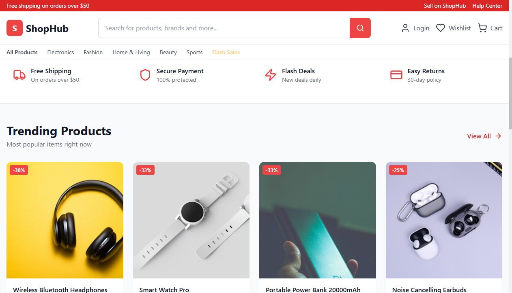
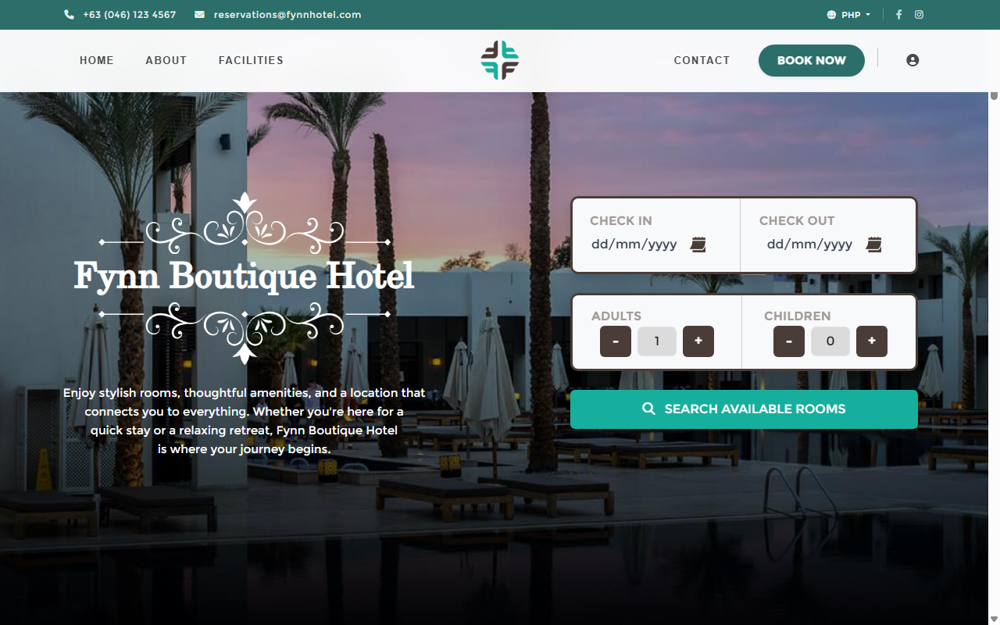
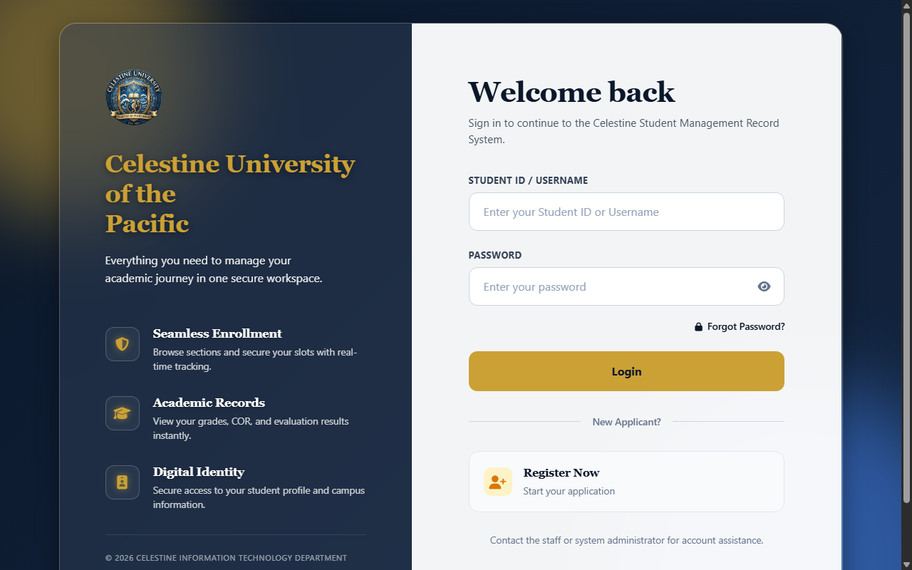
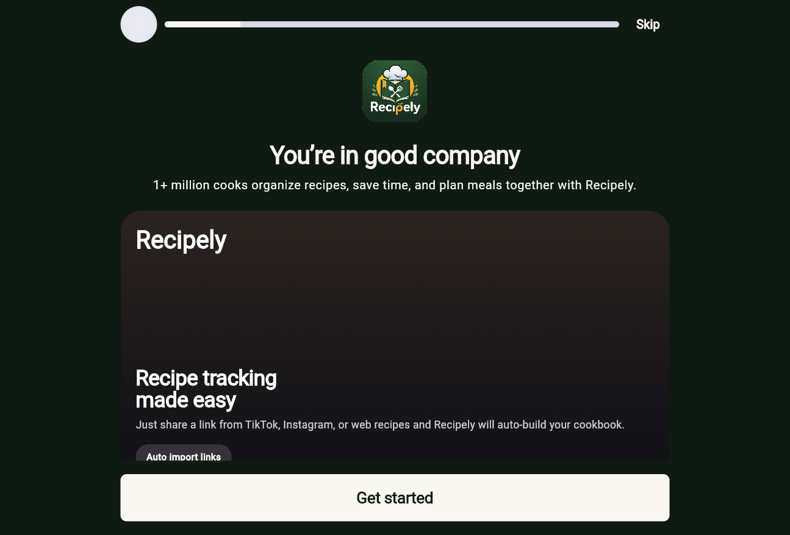
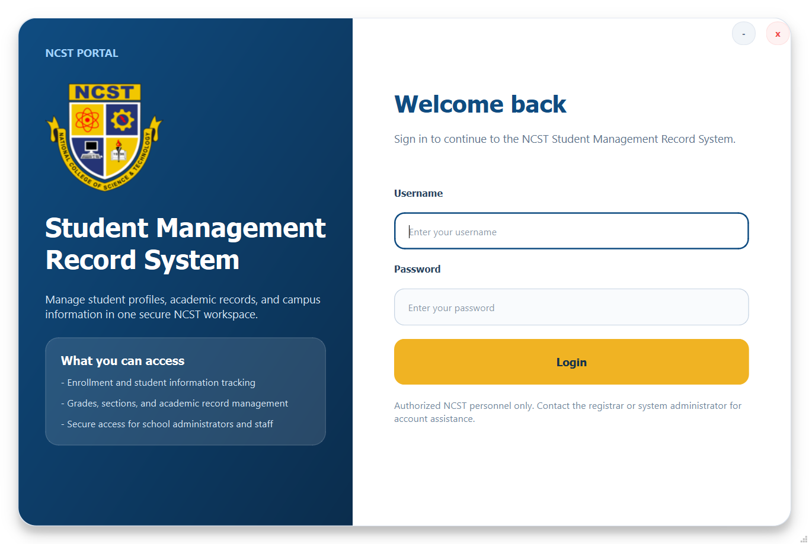
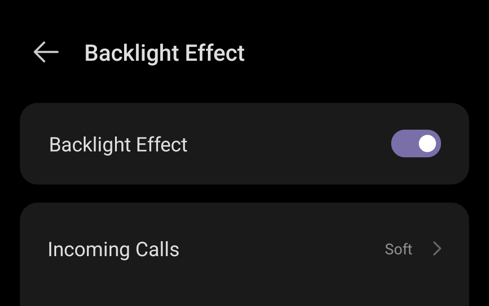

<!-- Header Banner -->

  

 

<!-- Introduction -->

  <h1>👋 Hi, I'm Albert Velez</h1>
  <h3>Software Engineer · Full Stack, Systems & Mobile</h3>
  
  
  
  
  

 

<!-- GitHub Snake & Contribution Grid -->

  <picture>
    <source media="(prefers-color-scheme: dark)" srcset="https://raw.githubusercontent.com/Yakuzokai/Yakuzokai/output/github-contribution-grid-snake-dark.svg">
    <source media="(prefers-color-scheme: light)" srcset="https://raw.githubusercontent.com/Yakuzokai/Yakuzokai/output/github-contribution-grid-snake.svg">
    
  </picture>

 

<!-- Technologies -->

  <h2>💻 Tech Stack</h2>
  
  #### Languages & Frameworks
  
  
  #### Backend, Systems & Infrastructure
  
  
  #### Databases & Cloud Services
  

    
    
    
    
    
    
  

  
  #### Tools & Platforms
  

 

<!-- Projects Section -->

  <h2>🚀 Featured Projects & Web Applications</h2>
  
  <table>
    <tr>
      <td align="center">
        <a href="https://github.com/Yakuzokai/E-commerce">
           
          <b>ShopHub Enterprise Platform</b>
        </a>
      </td>
      <td align="center">
        <a href="https://github.com/josephamasa-eng/Hotel-Project">
           
          <b>Fynn Boutique Hotel System</b>
        </a>
      </td>
      <td align="center">
        <a href="https://yakuzokai.github.io/">
           
          <b>Celestine University (SRMS)</b>
        </a>
      </td>
    </tr>
    <tr>
      <td align="center">
        <a href="https://github.com/Yakuzokai/recipely">
           
          <b>Recipely Mobile AI Platform</b>
        </a>
      </td>
      <td align="center">
        <a href="https://yakuzokai.github.io/">
           
          <b>NCST Student Record Management (SRMS)</b>
        </a>
      </td>
      <td align="center">
        <a href="https://github.com/Yakuzokai/LH8n_LightBelt_KSU_Module">
           
          <b>Tecno LH8n LightBelt Controller</b>
        </a>
      </td>
    </tr>
  </table>

 

<!-- Social Media -->

  <h2>🌐 Connect With Me</h2>
  
  
  
  
  

 

<!-- Contributions -->

  <h2>🤝 How to Collaborate</h2>
  
  🔍 Explore my open-source projects & architecture write-ups  
  🐛 Report issues or request features  
  💡 Suggest optimizations for distributed systems & embedded code  
  🌟 Star the repositories you find useful  

 

<!-- Languages -->

  <h2>🌍 Languages</h2>
  
  
  

 

<!-- GitHub Stats -->

  <h2>📊 GitHub Statistics</h2>
  
  <!-- GitHub Stats Card -->
    
  
  <!-- Most Used Languages -->
    
  
  <!-- GitHub Activity Graph -->
  

 

<!-- Footer -->

  
🚀 Open to full-stack engineering roles, systems architecture consulting & innovative collaborations.

